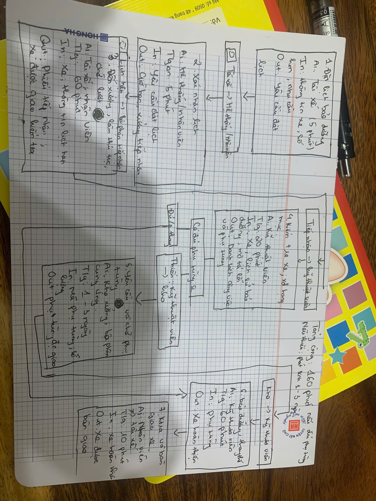

# Lab 02 — Báo cáo phân tích sâu
## Phase 3 — DEEP-DIVE
### 3.1 Current-State Workflow Mapping

### 3.2. Problem Statement (6-field) & Metrics
| Field | Nội dung chi tiết |
|---|---|
| **1. Actor / Operator** | Nhân viên, Kỹ thuật viên và Tài xế |
| **2. Current Workflow** |Tài xế đặt lịch qua hệ thống,nhân viên xác nhận. Tài xế đến xưởng, làm thủ tục và chờ lượt. Kỹ thuật viên kiểm tra xe yêu cầu phụ tùng nếu cần.Kỹ thuật viên bảo dưỡng, kiểm tra và nhân viên bàn giao bàn giao.|
| **3. Bottleneck** | Chờ tiếp nhận: Lịch hẹn chưa khớp với thời lượng công việc và năng lực thực tế của xưởng, Chờ phụ tùng: Phụ tùng cần dùng chưa được kiểm tra hoặc chuẩn bị trước, một số nhu cầu chỉ phát hiện sau khi kiểm tra xe. |
| **4. Business Impact** | Thời gian xe nằm xưởng kéo dài, tài xế không thể chạy xe, nhân viên phải giải thích, đổi lịch và xử lý tồn đọng.|
| **5. Success Metric** |giảm thời gian chờ tiếp nhận trung bình của xe đến đúng hẹn từ 60 xuống 30 phút, tính từ lúc check-in đến lúc kỹ thuật viên bắt đầu kiểm tra. |
| **6. Operational Boundary** | **Được phép**: Dự báo thời lượng, gợi ý phụ tùng có khả năng cần dùng, kiểm tra dữ liệu tồn kho và đề xuất lịch hoặc xưởng phù hợp. **Không được phép**: Tự kết luận hư hỏng, quyết định thay phụ tùng, đặt mua phụ tùng hoặc tự hủy/đổi lịch đã xác nhận. **Cần duyệt**: Nhân viên duyệt phương án lịch; tài xế đồng ý khi đổi lịch/xưởng, kỹ thuật viên xác nhận hạng mục và phụ tùng sau kiểm tra. |

### 3.3. Future-State Flow & AI Fit 
